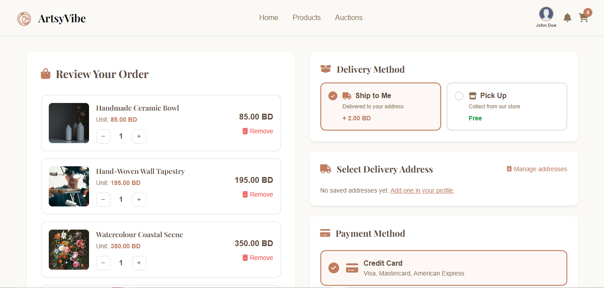
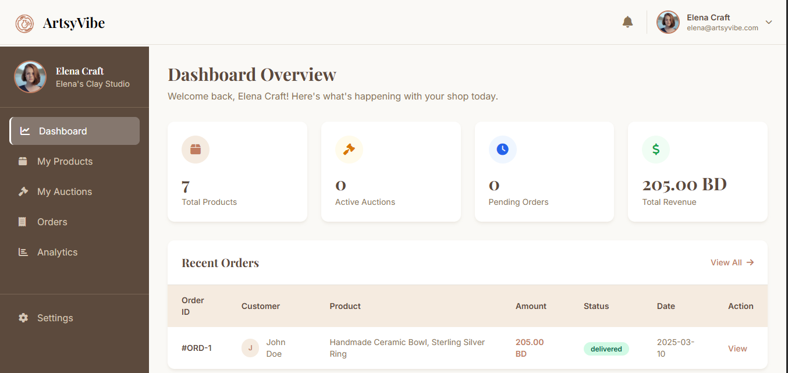
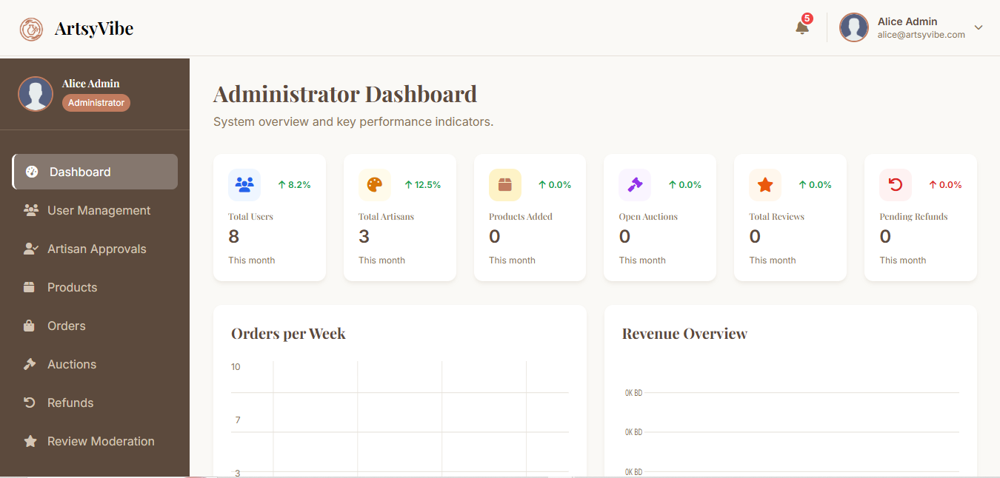
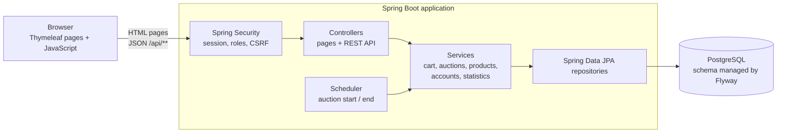

# ArtsyVibe: Local Artisan Cooperative

An online marketplace where local artisans sell handmade products and run live auctions, customers buy and bid,
and administrators moderate the whole platform.

Built with **Java 17 · Spring Boot 3 · Spring Security · Spring Data JPA · PostgreSQL · Flyway · Thymeleaf**.
Started as a university team project and later hardened for production use (security, data integrity, testing).

**Live demo:** <https://local-artisan-cooperative--aymanbouh05.replit.app>
(the server sleeps when idle, so the first visit can take up to half a minute)

| Role     | E-mail               | Password      |
|----------|----------------------|---------------|
| Admin    | alice@artsyvibe.com  | password123   |
| Artisan  | elena@artsyvibe.com  | password123   |
| Customer | john@example.com     | password123   |

| Shop | Checkout |
|---|---|
|  |  |
| **Artisan dashboard** | **Admin dashboard** |
|  |  |

---

## Features

### Customers
- Browse and search products by category and price range (min/max slider or exact values)
- Cart and checkout with saved addresses, delivery or store pickup
- Live auctions with countdowns, minimum-increment bidding and anti-sniping (a late bid extends the auction)
- Order history with per-item delivery status, refund requests with photos, and reviews of delivered items
- Wishlist, notifications (outbid, shipped, price drop, back in stock) and profile management

### Artisans
- Apply to sell (an administrator approves the account)
- Manage products and create auctions
- Fulfil orders: each artisan ships **only their own items**, even when an order contains items from several shops
- Answer refund requests (accept, decline with a reason, or escalate to an administrator)
- Analytics: revenue over time, best sellers, rating breakdown

### Administrators
- Dashboard with platform KPIs and recent activity
- Approve, reject or suspend artisans; manage users
- Moderate products (hide or publish, in bulk) and reviews
- Monitor live auctions (bid history, extend, cancel, flag)
- Final decision on refunds; orders and reports with date ranges
- Server-side search, filtering and pagination for users, products, reviews, orders and refunds

---

## How it works



Pages are rendered on the server with Thymeleaf. Interactive parts (cart, bidding, notifications, dashboards) call a
JSON API under `/api/**`.

### Security
- **Session-based authentication.** Logging in creates a server-side session (HttpOnly cookie). The server always
  takes the user's identity from that session; it never trusts an e-mail address or id sent by the browser.
- **Authorisation in two layers.** URL rules per role (customer, artisan, admin) in `SecurityConfig`, plus ownership
  checks in the code ("is this *your* order / product / address").
- **CSRF protection** with a token cookie and header, added automatically to every request by `static/app-core.js`.
- **Passwords** are hashed with BCrypt and never included in any response. Suspended accounts lose their session
  on the next request.
- User-generated text is escaped before it is inserted into the page (XSS protection), and image uploads are validated.

### Data integrity
- **No overselling.** Checkout locks the product rows (`SELECT … FOR UPDATE`, in a fixed order to avoid deadlocks)
  before checking and decrementing stock, so two buyers cannot both get the last item.
- **No lost bids.** Bidding locks the auction row, so simultaneous bids are applied one after another.
- **Exact money.** Prices and totals are `BigDecimal` / `numeric(12,3)` (the Bahraini dinar has three decimals).
- **Per-item fulfilment.** Every order line has its own status; the order's status is derived from its lines
  (it is only "shipped" when every artisan has shipped).
- **History is preserved.** Closing an account anonymises it, and products that were sold are hidden rather than
  deleted, so past orders, reviews and refunds stay consistent.

### Database migrations
The schema is versioned with **Flyway** (`src/main/resources/db/migration`); Hibernate only validates that the schema
matches the entities. Databases created by earlier versions of the app are upgraded automatically on start-up.

### Auctions
A scheduler moves auctions from *upcoming* → *live* → *ended* and sends the notifications (auction started, outbid,
won). The winner can then add the item to the cart at the winning price.

---

## Running locally

**Requirements:** JDK 17 or newer, and a PostgreSQL database.

```bash
export PGHOST=localhost PGPORT=5432 PGDATABASE=artisan PGUSER=postgres PGPASSWORD=postgres
./gradlew bootRun
```

Open <http://localhost:5000>. Flyway creates the tables on the first start.

**Demo data (optional).** On an empty database, start the app once, then load the sample accounts and products:

```bash
psql "postgresql://$PGUSER:$PGPASSWORD@$PGHOST:$PGPORT/$PGDATABASE" -f db/demo-data.sql
```

| Role     | E-mail               | Password      |
|----------|----------------------|---------------|
| Admin    | alice@artsyvibe.com  | password123   |
| Artisan  | elena@artsyvibe.com  | password123   |
| Customer | john@example.com     | password123   |

### Configuration

| Variable | Default | Purpose |
|---|---|---|
| `PGHOST`, `PGPORT`, `PGDATABASE`, `PGUSER`, `PGPASSWORD` | (none) | Database connection |
| `SESSION_COOKIE_SECURE` | `false` | Set to `true` when the site is served over HTTPS |
| `DEMO_REFRESH_STALE_AUCTIONS` | `false` | Demo only: re-opens ended auctions on start-up |

---

## Tests

```bash
./gradlew test
```

The suite (40 tests) runs against an in-memory H2 database in PostgreSQL mode, using the real Flyway migrations.
It covers, among other things:

- **Security:** spoofed identities are ignored, role and ownership rules, CSRF, password handling, suspended
  accounts losing their session
- **Concurrency:** several buyers racing for the last item, simultaneous bids on the same auction
- **Business rules:** exact money totals, winning-bid pricing, per-artisan fulfilment, refund eligibility
- **Every page renders** for every role, and admin search and paging work
- **Upgrading a database** created by an older version of the app

---

## Project structure

```
src/main/java/com/example/demo/
├── config/        start-up tasks and the auction scheduler
├── controller/    page controllers and the JSON API (/api/**)
├── dto/           validated request bodies
├── model/         JPA entities and role/status constants
├── repository/    Spring Data JPA repositories (queries, row locks)
├── security/      Spring Security configuration, CurrentUser
├── service/       business logic: cart & checkout, auctions, products, accounts, statistics
└── web/           error handling, paging, input validation helpers
src/main/resources/
├── db/migration/  Flyway migrations
├── templates/     Thymeleaf pages (customer, artisan, admin)
└── static/        JavaScript, images
db/demo-data.sql   optional sample data
```

The database design (ER diagram) is in
[`attached_assets/389_Project_-_ER.drawio_1778252832232.png`](attached_assets/389_Project_-_ER.drawio_1778252832232.png).

---

## Deployment

The project runs on [Replit](https://replit.com) (`.replit`): the app listens on port 5000 and uses Replit's
PostgreSQL. For production, use a single always-on instance (sessions are kept in memory) and set
`SESSION_COOKIE_SECURE=true`.

---

## Known limitations

- **Payments are simulated.** Checkout records a completed payment without charging anyone.
- **Images are stored in the database** (up to about 2 MB each); a file or object store would scale better.
- **Sessions are kept in memory**, so the app runs as a single instance.
- **"Forgot password" has no e-mail delivery yet.**
- **Orders cannot be cancelled** once placed (this would need restocking and refunding).
